<p align="center"></p>

<p align="center"><b>NextMON</b> (aplikasi) &nbsp;·&nbsp; <a href="https://github.com/FirmanKurniawan/NextMon-Server">NextMON Server</a> (peluncur Windows .exe) &nbsp;·&nbsp; <a href="https://github.com/FirmanKurniawan/NextMon/releases">Releases</a></p>

# NextMON — Hotspot MikroTik Manager generasi baru

Pesaing [Mikhmon](https://laksa19.github.io/) dengan UI glassmorphism/neumorphism futuristik, responsif, dan fitur jauh lebih lengkap
(grafik live, role & reseller, POS, notifikasi, QR voucher, backup otomatis, API, PWA, dll). Tanpa RADIUS — langsung via RouterOS API.

| Folder | Isi |
|---|---|
| [`nextmon-php/`](nextmon-php/) | Versi PHP + JS + HTML + CSS, ala Mikhmon (XAMPP / hosting / Docker) |
| [`nextmon-next/`](nextmon-next/) | Versi Next.js fullstack (TypeScript), multi-akun, fitur utama setara edisi PHP |
| [`shared/`](shared/) | Template login hotspot glass & template voucher cetak |
| [`docs/`](docs/) | PLAN, FEATURES (gap analysis), ARCHITECTURE, skrip RouterOS |

## Tampilan

Tangkapan layar asli dari edisi PHP dalam mode demo (data palsu, tanpa router sungguhan).

| | |
|---|---|
| 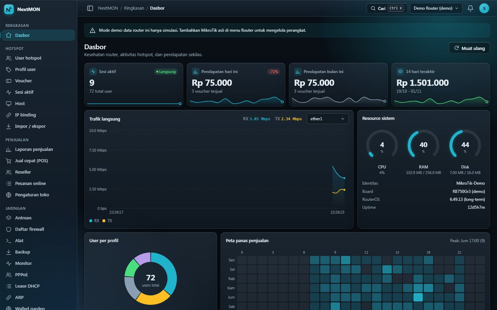<br><sub>Dasbor (tema gelap): sesi aktif, pendapatan, trafik langsung, resource router</sub> | 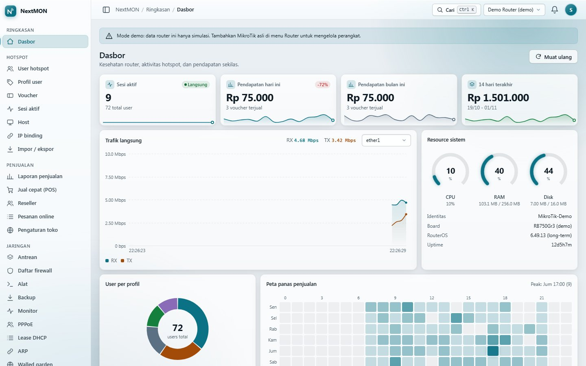<br><sub>Dasbor (tema terang) dengan peta panas penjualan</sub> |
| 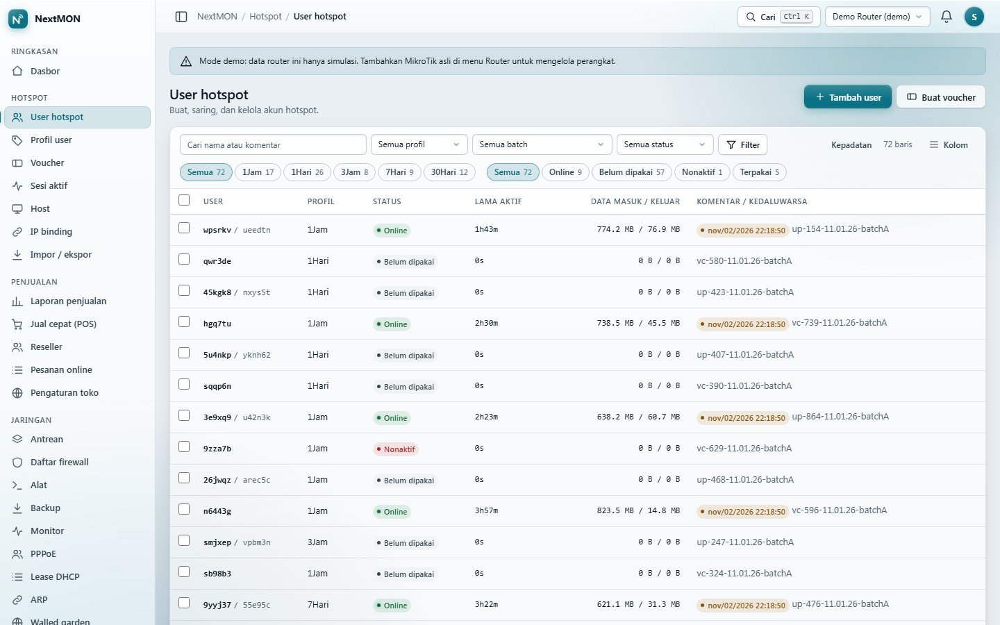<br><sub>User hotspot: filter profil, batch, dan status</sub> | 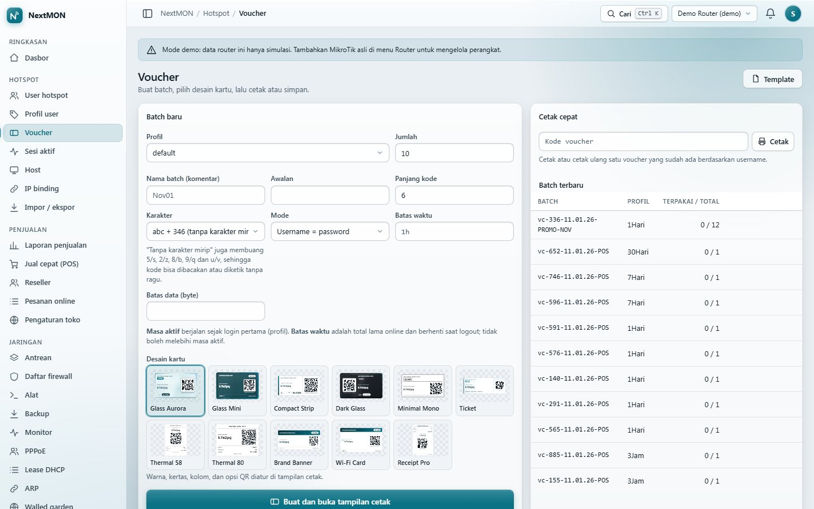<br><sub>Generate voucher: pilih profil, jumlah, karakter, dan desain kartu</sub> |
| 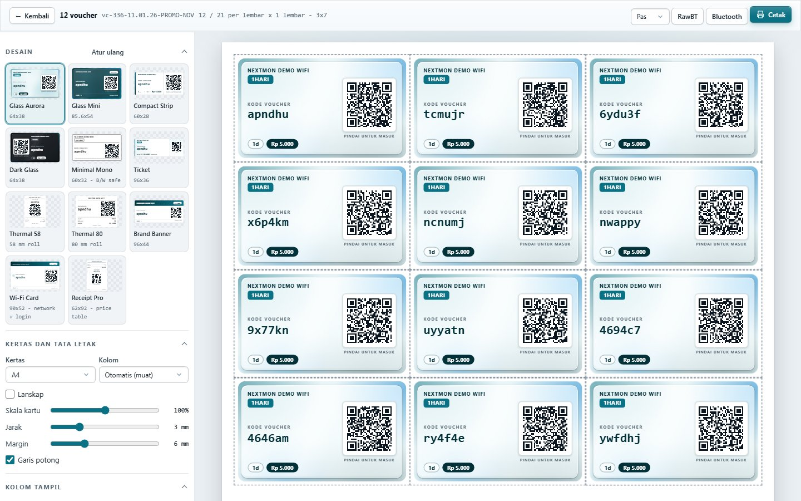<br><sub>Cetak voucher desain Glass Aurora dengan QR login</sub> | 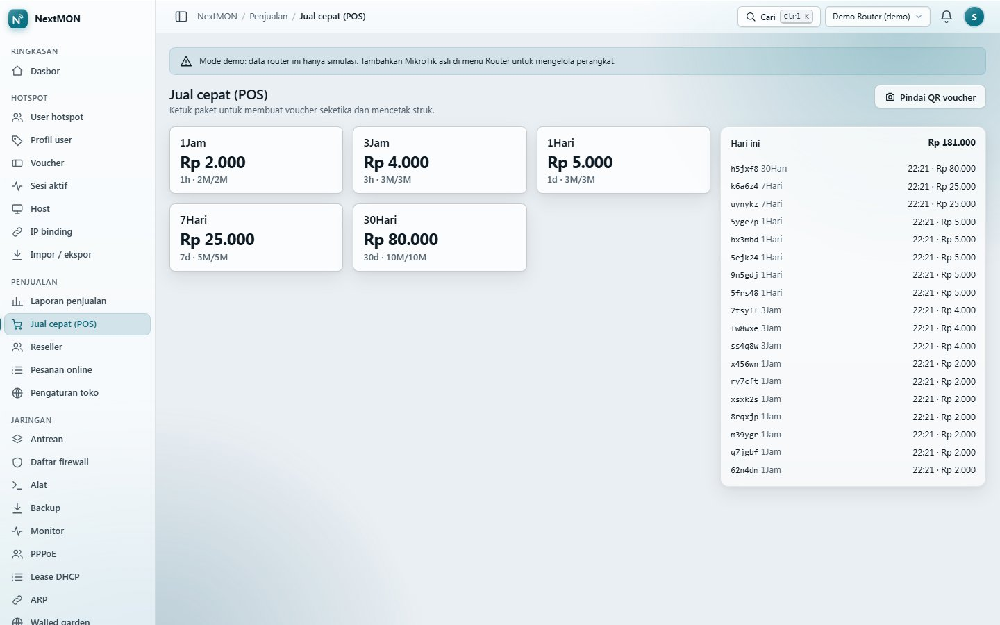<br><sub>Jual cepat (POS): satu ketukan satu voucher</sub> |
| 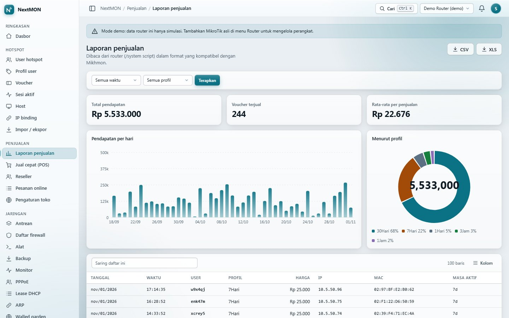<br><sub>Laporan penjualan: grafik harian dan ringkasan per profil</sub> | 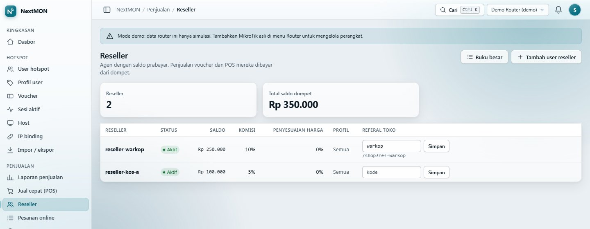<br><sub>Reseller: dompet prabayar, komisi, dan kode referal toko</sub> |
| 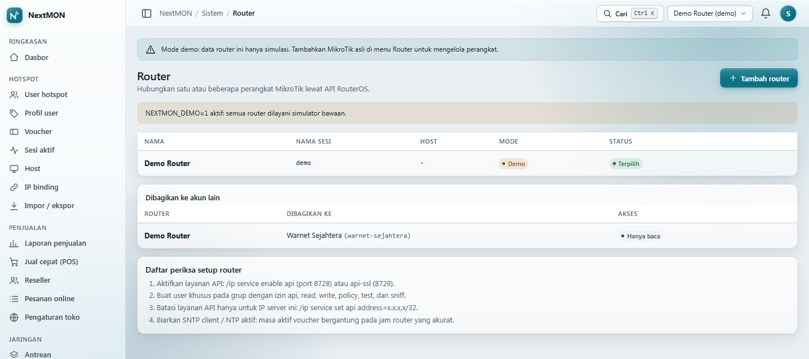<br><sub>Router, termasuk berbagi akses baca-saja ke akun lain</sub> | 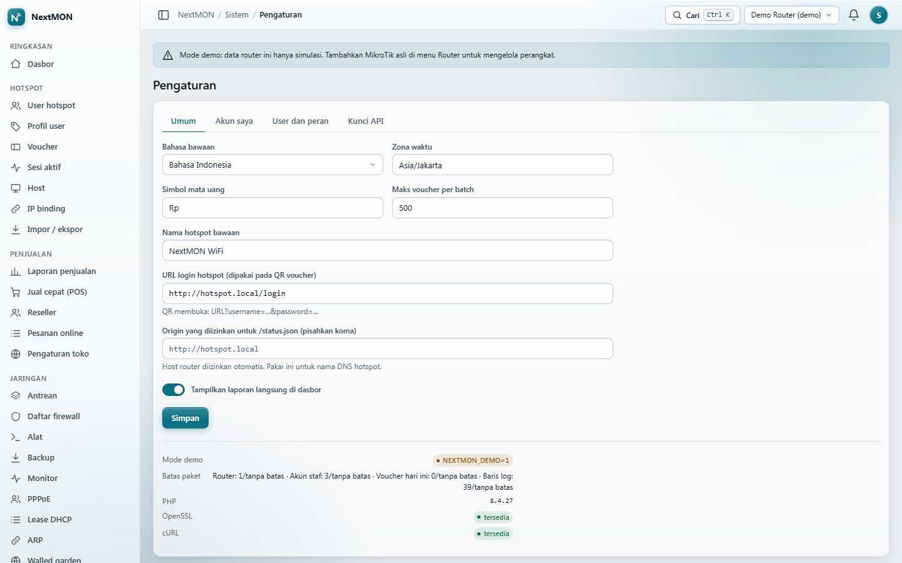<br><sub>Pengaturan umum dan batas paket akun</sub> |
| 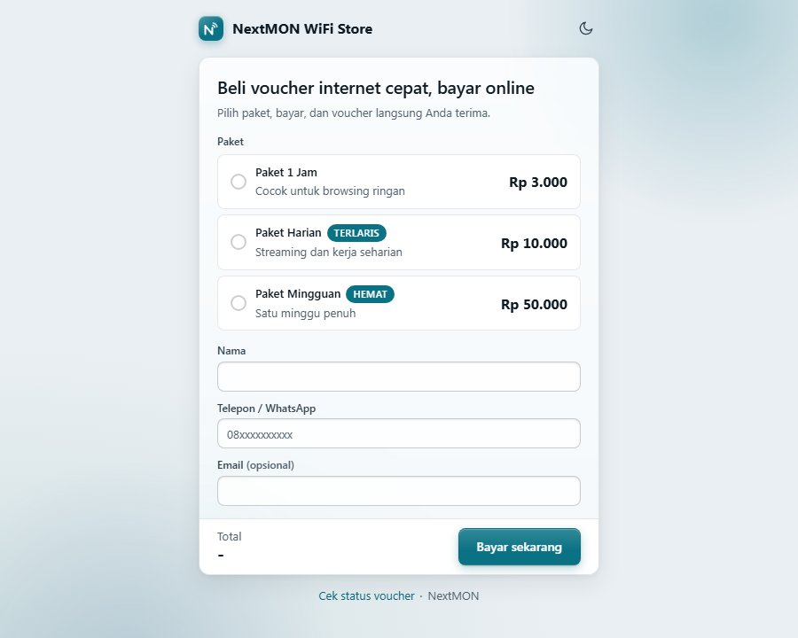<br><sub>Toko voucher publik (bayar online)</sub> | 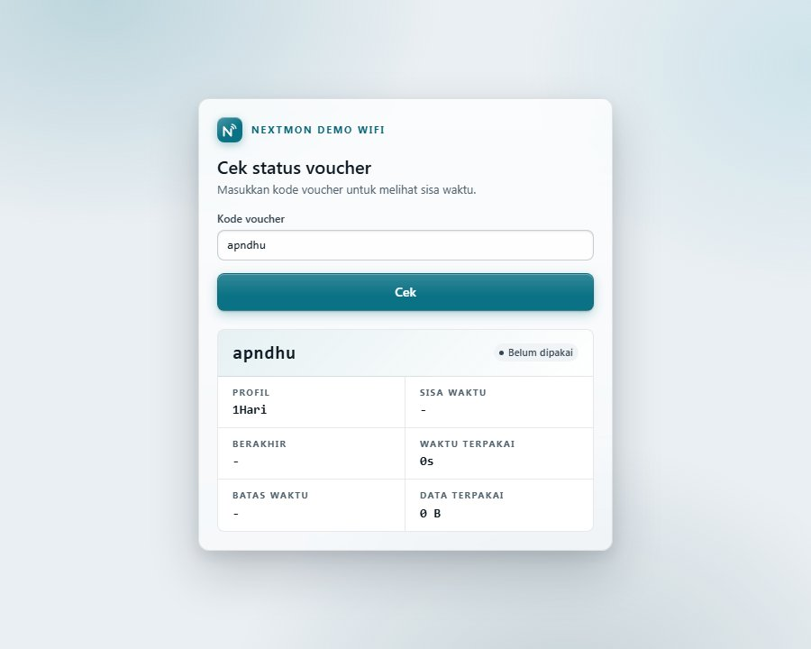<br><sub>Halaman publik cek status voucher</sub> |
| 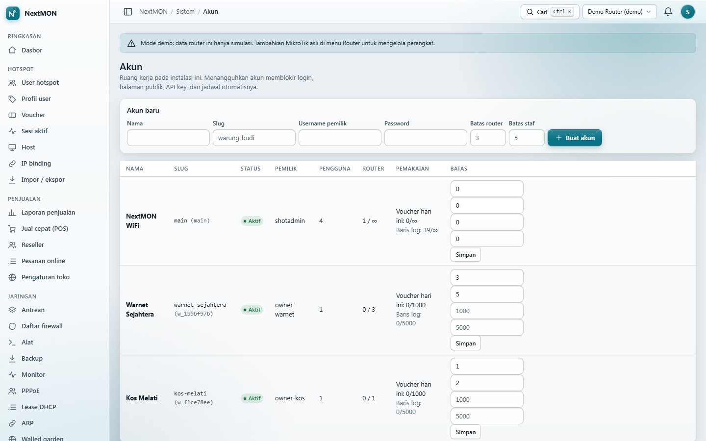<br><sub>Admin platform: banyak akun dengan batas masing-masing</sub> | 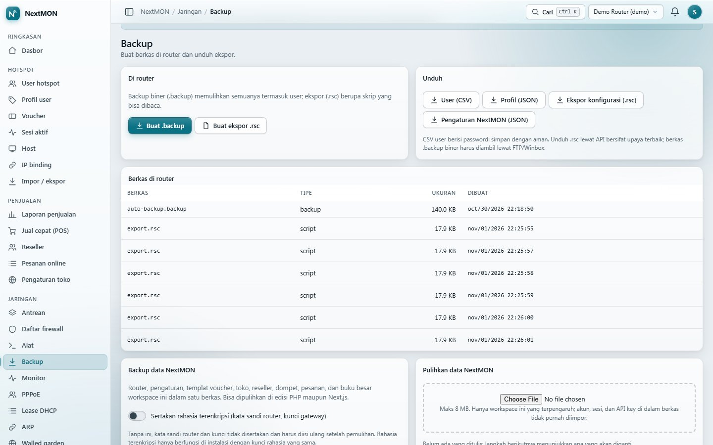<br><sub>Backup dan pulihkan data NextMON (opsional terenkripsi)</sub> |

<p align="center">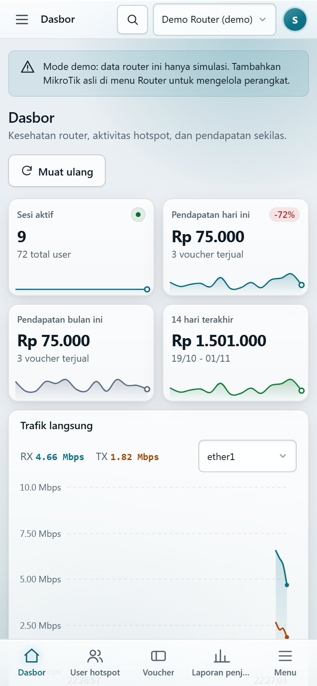<br><sub>Dasbor di ponsel (mobile-first, navigasi bawah)</sub></p>

## Cara termudah di Windows: NextMON Server
[**NextMON Server**](https://github.com/FirmanKurniawan/NextMon-Server) adalah peluncur `.exe` portabel (tray, panel kontrol, manajer runtime PHP/Node, backup, update) yang menjalankan **satu edisi** NextMON, PHP *atau* Next.js, tanpa instalasi. Unduh paket **lite** (runtime diunduh dari panel) atau **full** (PHP + Node bawaan) di halaman [Releases](https://github.com/FirmanKurniawan/NextMon/releases), ekstrak, lalu klik dua kali `NextMON Server.exe`. Petunjuk lengkap: [README NextMON Server](https://github.com/FirmanKurniawan/NextMon-Server#readme).

## Multi-akun
Satu instalasi bisa dipakai banyak pemilik: akun dibuat admin platform, tiap pemilik menambah router sendiri (data terpisah per workspace, router bisa dibagikan ro/rw). Spek: [docs/MULTITENANT.md](docs/MULTITENANT.md). Edisi PHP lolos suite isolasi (`nextmon-php/tests/tenant_isolation_test.php`); sebelum membuka layanan untuk orang lain tetap lakukan tinjauan keamanan sendiri.

## Mulai cepat
```bash
# Next.js
cd nextmon-next && npm install && npm run dev      # http://localhost:3000 (mode demo bawaan)

# PHP (butuh PHP 8.1+)
php -S localhost:8080 -t nextmon-php/public nextmon-php/public/index.php   # atau di Windows: .start-php.cmd
```
Kedua versi punya **mode demo** (data palsu) sehingga bisa dicoba tanpa router.

## Dokumen
[PLAN](docs/PLAN.md) · [FEATURES](docs/FEATURES.md) · [ARCHITECTURE](docs/ARCHITECTURE.md) · [AGENTS](AGENTS.md) · [MEMORY](MEMORY.md) · [CHANGELOG](CHANGELOG.md)

## Status
**Rilis v0.1.0.** Edisi PHP lengkap dan teruji (tes unit, smoke, keamanan, isolasi multi-akun). Edisi Next.js memiliki semua halaman utama edisi PHP (diuji dalam mode demo: 284 tes, build produksi, 41 halaman dimuat tanpa error); belum diuji dengan router asli dan kesetaraan fitur PHP dan Next.js dipetakan di `docs/PARITY.md` (sisa perbedaan kecil tercatat di sana). Catatan jujur: pengujian pada router MikroTik asli masih terbatas (koneksi dan dasbor sudah dicoba; skrip on-login/expiry, payment gateway live, dan cetak kertas belum). Lihat `release/RELEASE_NOTES.md` dan README tiap folder untuk detail.

Proyek independen, tidak berafiliasi dengan Mikhmon/Laksa19 maupun MikroTik. Kode ditulis dari nol berdasarkan dokumentasi RouterOS.
